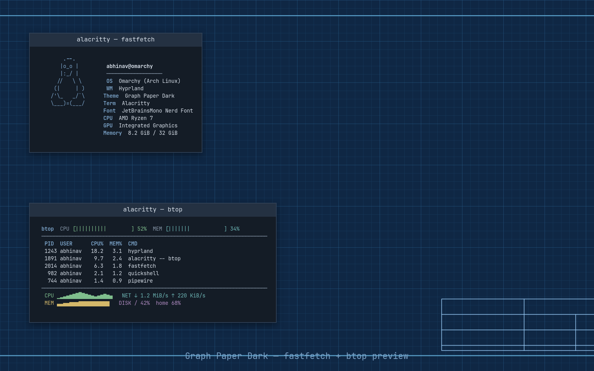

# Graph Paper Dark for Omarchy

A dark, engineering-inspired graph-paper theme for [Omarchy](https://omarchy.org/): blueprint surfaces, drafting grids, technical linework, and cool ink accents.



## Install

```bash
omarchy theme install https://github.com/abhinavbxr/omarchy-graph-paper-dark-theme
```

## Try locally

Copy this folder into your Omarchy themes directory and apply it:

```bash
cp -r /path/to/graph-paper-dark ~/.config/omarchy/themes/
omarchy theme set graph-paper-dark
```

## Backgrounds

Engineering/drafting-inspired wallpapers (all 2560×1440):

- `backgrounds/01-graph-paper.png` — classic dark engineering graph paper grid
- `backgrounds/02-blueprint-grid.png` — blueprint grid with border and title-block frame
- `backgrounds/03-isometric-grid.png` — isometric drafting grid for technical sketches
- `backgrounds/04-axes-circles.png` — axes, concentric construction circles, and measurement ticks
- `backgrounds/05-mm-engineering-paper.png` — fine millimeter-style engineering paper with major/minor grid
- `backgrounds/06-schematic-sheet.png` — schematic/drawing sheet with construction geometry and dimension guides

Cycle backgrounds with `omarchy theme bg next`.

## Previews

- `preview-fastfetch-btop.png` — 1920×1200 preview composition showing fastfetch and btop on the theme
- `preview.png` — 1600×900 base preview image
- `preview.webp` — 1200×675 web preview asset derived from the fastfetch+btop preview

## Palette

Defined in `colors.toml`:

| Role | Color |
| --- | --- |
| Background | `#1b2430` |
| Foreground | `#d8e0ea` |
| Accent | `#7aa2c7` |
| Selection | `#33445a` |
| Muted | `#5b6f86` |

Omarchy generates application themes from `colors.toml`.

## Files

- `colors.toml` — core theme palette
- `icons.theme` — icon theme name (`Yaru-blue-dark`)
- `backgrounds/` — theme wallpapers (6 images)
- `preview-fastfetch-btop.png` — fastfetch + btop preview
- `preview.png`, `preview.webp` — additional preview assets
- `README.md`, `LICENSE`

## Community theme compatibility

Prepared for [omarchy-site community theme submission guidelines](https://github.com/omacom/omarchy-site#adding-your-theme) (not submitted):

- Theme is installable from its own repository URL and keeps required theme files/assets.
- Includes 16:9 preview assets (`preview.webp`, 1200×675).

**Before submitting to the community gallery:** replace the preview with a real 16:9 desktop screenshot of the theme in use (terminal + editor visible, using this theme’s wallpaper, no cursor/notifications/personal info), then convert as recommended:

```bash
magick preview.png -strip -resize '1200>' -quality 80 graph-paper-dark.webp
```

## License

MIT
