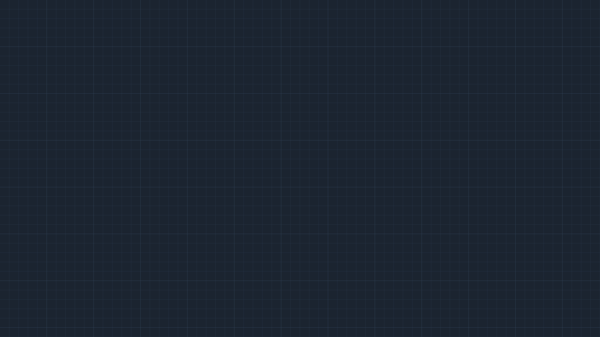

# Graph Paper Dark for Omarchy

A dark graph-paper theme for [Omarchy](https://omarchy.org/): deep slate surfaces, precise grid lines, and cool ink accents inspired by engineering notebooks and blueprint paper.



## Install

```bash
omarchy theme install https://github.com/abhinavbxr/omarchy-graph-paper-dark-theme
```


## Try locally

Copy this folder into your Omarchy themes directory and apply it:

```bash
cp -r /path/to/graph-paper-dark ~/.config/omarchy/themes/
omarchy theme set graph-paper-dark
```

## Backgrounds

- `backgrounds/01-graph-paper.png` — generated dark graph-paper wallpaper (2560×1440)

Cycle backgrounds with `omarchy theme bg next`.

## Palette

Defined in `colors.toml`:

| Role | Color |
| --- | --- |
| Background | `#1b2430` |
| Foreground | `#d8e0ea` |
| Accent | `#7aa2c7` |
| Selection | `#33445a` |
| Muted | `#5b6f86` |

Omarchy generates application themes from `colors.toml`.

## Files

- `colors.toml` — core theme palette
- `icons.theme` — icon theme name (`Yaru-blue-dark`)
- `backgrounds/` — theme wallpapers
- `preview.png` — theme preview image

## License

MIT
